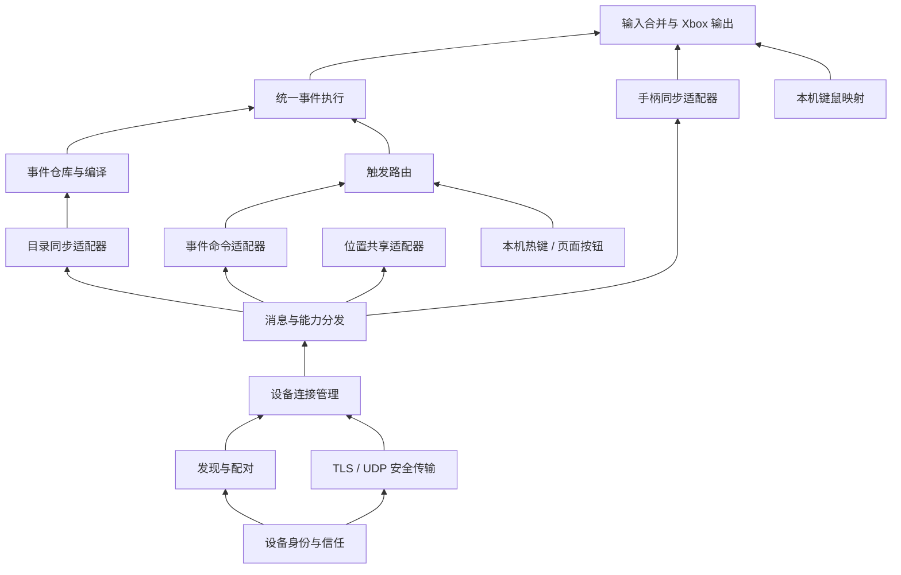

# 设备互联与事件执行：完整链路审查及能力模块拆分

日期：2026-09-13  
审查基线：`feat/offline-installer` / `afae064`，开始审查时工作区干净。  
状态：审查与结构提案；尚未实施生产代码重构，尚未重新打包。

## 1. 结论与范围

设备之间的连接应当成为独立底层能力。事件目录、事件触发、手柄同步和位置共享通过各自适配器使用连接，不应决定连接能否建立，也不应通过各自的启停隐式重启整套网络。

现有代码有值得保留的实现：独立的 C# LAN 库、身份和信任持久化、配对认证、TLS/UDP、输入防重放与过期释放，以及多来源 Xbox 状态合并。问题集中在生命周期、业务协议、事件定义和状态解释跨模块混在一起。建议从现有实现抽取能力，逐步收拢重复入口。

本轮沿实际链路审查了：工作台页面 → 本机热键/手动发送 → 事件目录与路由 → Host 命令入口 → 配对/会话/TLS/UDP → 远端消息消费 → 事件调度 → Xbox 状态合并。也检查了位置共享、跟随接入点及现有导航事件架构，确认复用边界。并非对全仓库所有地图、识别和导航算法进行逐行审查；本阶段不扩展定位、跟随功能。

证据分三类：**已复现**（隔离探针）、**源码确认**（确定控制流）、**待现场验证**（实际设备故障是否由此引起、性能程度）。本轮没有向真实远端发送操作，没有确认游戏实际接收输入。

## 2. 优先处理的问题

### 2.1 设备连接与消息隔离

| 优先级 / 证据 | 位置（仓库相对路径） | 发现与影响 | 应归属的能力 |
| --- | --- | --- | --- |
| P1 / 已复现 | `lan_input_sync/src/LanInputSync/LanSyncService.Control.cs:326` | 接收 JSON 限制 `MaxDepth=8`，合法的目录内并行步骤达到 9 层；解析异常使控制循环退出，finally 关闭整个设备会话。 | 消息契约、业务适配器的错误隔离 |
| P1 / 源码确认 | `LanSyncService.cs:233`、`:237`、`:334` | 重复启动先关闭健康连接或替换连接版本，再检查是否已有连接任务。第二次请求可能被拒绝，同时使第一次请求的版本失效。批量连接中单个异常还会中止剩余设备。 | 按设备管理的幂等连接生命周期 |
| P1 / 源码确认 | `LanSyncService.cs:295`、`:312` | `ConfigureLocked` 对普通配置修改也执行全局 `EmergencyStop`、取消网络任务、重建监听；改名称、事件权限或速率也会影响其他设备。 | 配置差异应用、能力独立启停 |
| P1 / 源码确认 | `LanSyncService.Control.cs:121`、`LanSyncService.SharedData.cs:38` | 建立连接依赖 `share/receive` 业务模式和接收授权；数据连接与手柄连接由 `DataOnly` 分支互斥。同一设备不能自然组合多种能力。 | 设备连接与能力协商分离 |
| P1 / 源码确认 | `LanSyncService.SharedData.cs:97`、`:112`、`:142` | 事件/目录共用控制发送队列，满了就关闭会话；接收事件全局队列满时关闭当前发送者，A 堆满队列可能让 C 的下一条消息遭遇断连。 | 按设备、能力分队列和背压 |
| P1 / 源码确认 | `LanSyncService.Transport.cs:112`、`:134` | 网络循环外层异常处理会关闭全部会话；应区分监听器故障与单设备、单消息失败。 | 传输故障隔离 |
| P2 / 源码确认 | `LanSyncService.cs:339` | 旧连接任务的 catch 不检查当前 ticket/generation，可能在新连接成功后写回旧错误。 | 每设备状态机和诊断版本 |
| P2 / 源码确认 | `LanSyncService.cs:374`、`LanSyncService.SharedData.cs` | 连接健康、UDP 新鲜度、手柄输入 200ms 时限及事件 TLS 投递相互绑定。短暂 UDP 问题可能影响仅事件用途的连接。 | 连接健康与输入有效期分离 |
| P2 / 源码确认 | `LanSyncService.cs:345`、`virtual_gamepad/ui/virtual_gamepad_ui/sync_panel.py:372` | `connected`、`syncing` 分别取自不同阶段；UI 把通用数据会话称作事件通道，并混合展示历史错误。无法明确说明“连接正常、事件未授权、执行器未就绪”。 | 分层状态快照 |

表中未写目录的 `LanSyncService*` 均位于 `lan_input_sync/src/LanInputSync/`。

**并行目录的最小复现。** .NET 8 使用真实序列化器生成：

```json
{"type":"shared-catalog","catalog":{"definitions":[{"steps":[{"op":"parallel","tracks":[{"buttons":["A"],"mode":"once"}]}]}]},"challenge":1}
```

目录为 90 字节，完整消息为 140 字节，均低于当前 6000/8192 字节限制。`MaxDepth=8` 拒绝，`MaxDepth=9` 接受。沿 `RunControlsAsync` → `AcceptClientAsync` / `StartOutgoingAsync` 的 finally，会执行 `CloseLocked(..., "control_disconnected")`。这证明合法目录可以关闭连接；是否对应用户此次现场断连，仍需对应时段日志确认。

修复不能只是把 8 改成 9：发送、接收、事件编译器需要共享可支持的结构与限制；业务负载不支持时返回该能力的错误。认证失败、帧边界破坏等仍可关闭连接，不能把所有异常一律吞掉。

**纠正上次的启动竞态结论。** `afae064` 的说明称后台线程可能先看到旧版本，但原 `Handle` 和后台 `ConnectTls` / 注册会话使用同一把 `_gate`，不支持这个解释。当前更具体的问题是：重复请求先改变 `_startVersions`，随后 `ScheduleConnection` 因已在连接中而拒绝，原任务又因版本不匹配取消。不能将上一版视作已经证明解决多设备异常。

现有数据会话本身可以双向传事件；B 与 A 建立数据会话后，不需要为反方向再建一条独立业务连接。但双方同时拨号目前没有明确仲裁，目标结构需要处理该情形。

### 2.2 事件定义、触发与执行

| 优先级 / 证据 | 位置 | 发现与影响 | 应归属的能力 |
| --- | --- | --- | --- |
| P1 / 已复现 | `core/runtime/remote_event_runtime.py:26`、`:59` | 用事件名称构造 definitions，并把 ID 解析回名称。两个设备同名事件会相互覆盖，最终可能执行错误定义。 | 稳定事件标识与定义仓库 |
| P1 / 已复现 | `core/runtime/local_event_runtime.py:154` | `any(sessions[target].start(...) for target in targets)` 短路；Controller 1 启动成功后 Controller 2 根本不调用。 | 多目标路由、逐目标结果 |
| P1 / 已复现 | `core/events/event_lifecycle.py:120` | 顶层 ONCE 轨道用整个事件的累计时间，重复两次时第二次不重新按下；顺序步骤采用另一套取模逻辑。 | 统一时间轴与重复语义 |
| P1 / 源码确认 | `gui/modes/events/workbench.py:210`、`:217`、`:239` | UI 直接写文件、复制时沿用 ID、owner 默认字面值 `local`；删除物理移除但未可靠同步删除标记。编辑语义绕过 `EventStore`。 | 事件仓库独占写入 |
| P1 / 源码确认 | `core/events/event_store.py:50` | 远端更新主要按 ID/revision 合并，缺少 owner 与认证来源的绑定。还存在多个文件写入者，可能丢失更新。 | 所有权校验、原子持久化 |
| P1 / 源码确认 | `core/runtime/event_catalog_runtime.py:128`、`remote_event_runtime.py:100` | 两条路径都能消费目录；一条更新磁盘，另一条执行器不一定刷新内存 definitions。 | 单一目录订阅与仓库变更通知 |
| P1 / 源码确认 | `core/lan_follow/follow_transport.py:58`、`remote_event_runtime.py:100` | 跟随和远端事件运行时都 drain 同一份共享消息，组合运行时可能互相取走消息。 | 消息分发与按能力订阅 |
| P1 / 源码确认 | `core/runtime/remote_event_runtime.py:118`、`:132` | 执行实例没有完整保存发送设备/会话归属；统一 `event:remote` 源不断续期，连接消失后已启动循环没有按来源中止策略。 | 执行实例、来源与取消范围 |
| P2 / 源码确认 | `core/runtime/local_event_runtime.py:44`、`:120` | 同一热键多条路由覆盖，界面提供的普通键/方向键与运行时仅识别 F 键不一致。 | 共用键定义、触发适配器 |
| P2 / 源码确认 | `core/events/action_tracks.py`、`event_lifecycle.py` | 顶层 continuous 与并行步骤 continuous 语义不同；部分编辑器提供的步骤、标志未由当前执行路径处理。 | 定义校验、统一编译执行 |
| P2 / 源码确认 | `core/runtime/remote_event_runtime.py:125`、`gui/modes/events/workbench.py:109` | 即使所有目标启动失败也增加接收计数；发送成功只代表排入本机队列，缺少远端执行回执。 | 逐阶段、逐目标诊断 |

隔离验证结果：同名 X/Y 事件最终仅保留一个定义；双目标表达式仅启动 `[1]`；100ms 的顶层单次轨道设置两次执行，在 150ms 无第二次按下。原有 `tests/test_event_lifecycle.py`、`tests/test_event_session.py` 共 12 个测试通过，说明现有正常路径测试未覆盖这些情况。

### 2.3 装配与界面

- `EventWorkbenchPage` 构造函数直接创建多个运行时，页面还负责业务文件写入。页面生命周期和后台能力混在一起。
- 独立局域网页和虚拟手柄页复用 `SyncPanel`，但各持有控制入口，shutdown 都能调用全局 `sync.stop`。应共享状态与装配入口，按使用范围停止能力。
- `ControllerRegistry.HandleSync` 使用输入路由的 `_routingGate`。目录/状态处理可能占用输入路径同一把锁；这是源码可见的争用风险，尚未实测延迟程度。
- Host 同时装配 LAN、RawInput、Xbox；驱动不可用时有 Null 后端，并非 LAN 必然无法启动。但依赖装配仍应允许仅连接/发送事件，无须激活键盘拦截或真实手柄输出资源。

## 3. 先统一概念

| 概念 | 含义与职责 |
| --- | --- |
| 配对 | 建立设备身份信任。可以处于已配对但未连接状态。 |
| 设备连接 | 与一个已认证设备的逻辑会话，包含存活状态与会话代次；底层可以有 TLS、UDP 多条传输。 |
| 能力通道 | 某设备连接上协商启用的业务能力，按能力、方向管理权限。不是每种能力都另开一个套接字。 |
| 事件定义 | 创建者拥有的可版本化配置，标识是 `(ownerDeviceId, eventId)`，名称只是显示用。 |
| 触发规则 | 输入来源、事件标识、执行目标、触发/停止方式之间的绑定。属于本机配置，不随事件共享而覆盖另一台热键。 |
| 执行请求 | 一次 start/stop 等指令，带请求 ID、事件版本、目标列表和有效期。 |
| 执行实例 | 某设备某手柄正在执行的一次事件，有独立实例 ID、来源和取消范围。 |
| 执行器 | 在目标设备将已校验事件转为输入状态；事件创建者不等于执行设备。 |

A、B、C 只用于描述场景，不写成设备全局角色。B 可以同时给 A/C 发事件，也可以接收它们的目录或请求。

## 4. 按能力自底向上拆分

| 层次 | 能力模块 | 对外承担的工作 | 复用与迁移来源 |
| --- | --- | --- | --- |
| 基础 | 设备身份与信任 | 稳定设备 ID、证书、配对记录、信任撤销 | `IdentityStore.cs` 与现有信任文件 |
| 基础 | 发现与配对 | 地址发现、配对码、确认、身份验证 | 现有广播发现与 `Control.cs` 配对流程 |
| 基础 | 安全传输 | TLS 控制帧、UDP 收发、加密、防重放 | `Control.cs`、`Transport.cs`、`SecurePackets.cs` |
| 基础 | 设备连接管理 | 每设备连接/断开/重试、幂等、多连接仲裁、健康状态 | `LanSyncService` 的会话、generation、ticket 逻辑 |
| 基础 | 消息与能力分发 | 能力注册、权限、按设备队列、分发、传输层回执 | `SharedData.cs` 的通用部分；不识别事件按键语义 |
| 适配 | 手柄同步 / 事件命令 / 目录同步 / 位置共享 | 四个独立适配器，各自约定负载、有效期和投递策略 | `ReceiverSlot`、SharedData、EventCatalogRuntime、FollowTransport |
| 业务 | 事件定义仓库与编译 | 所有权、版本、删除标记、持久化、配置校验、编译后的执行快照 | `event_store.py`、`event_catalog.py` 与现有轨道校验 |
| 业务 | 触发路由与事件执行 | 本机热键/按钮/远端消息接入，目标展开，顺序/并行/重复/停止 | local/remote/sender runtime、EventSession、EventLifecycle |
| 动作 | 输入合并与设备输出 | 按来源/控制器合并输入、TTL、取消释放、提交 Xbox | ControllerRegistry、StateStore、gamepad_output、core/actions |
| 应用 | 工作台装配与诊断 | 持有后台运行时、配置变更、统一状态日志；页面只编辑和下达请求 | HostComposition、core/runtime、gui 页面 |

能力模块不等于进程或独立项目。连接管理、队列、身份可以先作为同一 C# 库的内部模块；事件调度继续使用 Python；保留现有 Host 与统一启动入口。只有真实的性能或隔离要求才能成为增加进程的理由。



工作台装配模块连接这些能力，GUI 依赖装配后的应用接口和状态快照。基础连接模块不得反向 import 事件、手柄驱动、游戏对象或 GUI。

## 5. 必须守住的行为边界

### 5.1 连接、通道和启停

1. 所有业务能力关闭时，仍能配对、建立设备连接、查看在线状态。
2. 一个逻辑连接承载多个能力；支持 A/B/C 多设备，每个设备独立状态、重试及错误。启动已连接设备返回当前状态，启动连接中的设备复用已有任务。
3. 双向同时拨号通过双方一致的设备 ID 仲裁规则收敛到一个会话；替换动作必须核对当前会话代次。
4. 关闭事件接收只停止事件请求受理，并按事件执行策略处理现存实例；不停止位置共享和手柄同步。关闭目录共享也不撤销配对。
5. 普通配置热更新；绑定地址/端口等需要重建传输的变更才执行明确的网络重启。
6. “停止事件”“停用某能力”“断开设备”“解除配对”“紧急释放全部输入”是不同动作，分别定义范围。
7. 保留手柄输入的短时过期释放；网络暂时不可用时先释放对应输入，不用延长输入时限来掩盖连接抖动。逻辑连接再按独立健康策略恢复。

### 5.2 消息与数据策略

| 能力 | 消息特征 | 排队与失败处理 |
| --- | --- | --- |
| 手柄状态 | 连续状态，短有效期 | 保留现有状态更新、可靠按键变化及过期释放；过时状态不补发 |
| 事件命令 | 离散指令，要求可追踪 | 有界可靠投递、请求去重、过期拒绝、逐目标回执；只在有效期内重试 |
| 事件目录 | 版本化配置，可恢复 | 同设备合并待发版本，摘要/差异或分片同步；超限明确失败，不断开其他能力 |
| 位置共享 | 高频最新观测 | 按对象保留最新值，带观测时间与新鲜度；不积压历史位置 |

同一接收队列只由统一分发入口读取，再交给各能力。观察日志可以多订阅，业务命令只能由指定处理器执行一次。目录变更通过仓库通知刷新执行定义，运行中的实例固定使用启动时的版本快照。

认证设备 ID 由传输层附加到接收上下文，不能信任 payload 自报来源。目录首次同步以创建者为权威；事件创建者可以控制别的执行设备，但不能改写其他创建者的定义。如果以后要转发第三方目录，需要另定义来源验证，不能默认相信转发者的 owner 字段。

跨电脑有效期必须有明确定义：使用已协商时钟偏移或带传输时间估计的有效期策略；不能直接比较两台机器的单调时钟绝对值。执行节奏由接收端本地单调时钟调度。

### 5.3 事件和 Xbox 输出

- 本地定义只能由本机修改，远端定义只读；复制生成新 ID 和本机 owner。删除写入带版本的 tombstone，远端能够删除旧目录项。
- 本机热键和远端消息进入同一个校验、目标展开、执行引擎；定义、路由规则、运行实例分别存储。
- 请求显式标识目标设备和 Controller 1/2。广播在发送时展开为在线且已授权的设备快照，返回逐设备结果；新上线设备不会补执行过期触发。
- 同一热键可对应多条规则。先执行所有目标，再汇总结果，避免 `any` / `all` 的短路副作用。
- 统一顺序、并行、单次、持续、频率、执行次数、循环和停止语义。统一编译器对未支持步骤明确拒绝，不能让编辑器保存后悄悄跳过。
- 每个执行实例携带 requestId、originDeviceId、originSessionId、definitionKey、revision、controller。重传去重和“用户再次触发是否重启”是两个不同策略。
- 连接丢失时推荐停止该来源的循环实例并释放其输入；短序列是否允许完成由显式执行策略决定。不得清掉其他设备、本机映射的输入。
- 复用 ControllerRegistry 的多来源状态合并和 TTL。默认保留已实现的按钮 OR、轴合并策略；优先级/独占需要显式策略，避免暗中改变游戏手感。
- 定时执行不等待远端往返；收到并验证请求后，在执行设备本地运行整个序列。本轮不引入技能画面确认。

### 5.4 可观察性与页面职责

连接状态、能力状态、执行器状态分别展示。例如：`设备 A 已连接 · 事件允许接收 · 目录同步完成 · Controller 1 就绪`，而不是只有“同步中”。

同一个 requestId 贯穿：触发 → 本机排队 → 远端收到 → 校验通过/拒绝 → 对应控制器实例启动 → Host 接受状态 → 驱动提交结果 → 完成/取消/释放。队列成功只能显示“已排队”。驱动提交成功也不等于确认游戏释放了技能。

设备页面负责配对、连接和能力授权；事件页面负责定义与触发规则；手柄页面负责控制器、键鼠映射与输出观察。页面切换不重启后台能力。事件发送端只启用触发监听即可，不必启用输出手柄；执行端开启事件执行能力即可，不必启用键盘映射。应用启动时由配置决定恢复哪些能力。

## 6. 建议目录与旧实现映射

以下是目标结构，按阶段迁移，不先批量搬文件：

```text
device_link/                         # 从 LanInputSync 抽出的通用 C# 库
  src/DeviceLink/
    Identity/
    Discovery/
    Pairing/
    Transport/
    Connections/
    Messaging/
  tests/

lan_input_sync/                      # 手柄同步能力 + 旧 sync.* 兼容入口
  .../GamepadSync/
  .../Compatibility/

core/communication/                 # Python 对 Host 互联能力的客户端适配
core/events/
  catalog/                          # 现有 store/catalog 收拢
  execution/                        # 现有 tracks/lifecycle/session 收拢
  triggers/                         # 热键、页面、远端请求的路由
  ...                               # 保留既有感知/导航事件模块
core/runtime/                       # 应用装配和运行时生命周期
core/actions/                       # 已有设备动作适配器
virtual_gamepad/host/                # 已有输入合并、Xbox 后端与 Host 装配
gui/modes/lan/                       # 配对、连接与能力授权
gui/modes/events/                    # 定义、规则、运行日志
```

| 当前实现 | 迁移处理 |
| --- | --- |
| `LanSyncService` 多个 partial 文件 | 先在库内拆出连接/传输/消息职责，再移动通用实现到 DeviceLink；旧门面只做兼容翻译 |
| `IdentityStore`、`SecurePackets` | 保留算法和已有测试；抽取不得改变设备 ID 或使已有配对失效 |
| `ReceiverSlot`、UDP 手柄 lanes | 保留在手柄同步能力；连接库不再持有控制器状态 |
| `SharedData` 的 position/event/catalog 分支 | 拆成业务适配器，公用消息外壳、认证上下文和队列管理 |
| `EventStore` + UI 文件写入 + 目录同步落盘 | 收为单个定义仓库写入口；原子替换、串行写入、变更通知 |
| `local_event_runtime` / `remote_event_runtime` / `remote_event_sender` | 保留兼容启动入口，内部委托统一触发路由与执行器，删除重复解析与调度 |
| `ActionTrack` / `EventLifecycle` / `EventSession` | 扩展修复现有实现成为统一编译/执行模块，不另写一套宏引擎 |
| `FollowTransport` | 订阅位置与所需命令，停止 drain 全局消息；本轮不开发跟随算法 |
| `ControllerRegistry` / `StateStore` | 复用状态合并、释放、TTL；LAN 命令从输入锁中分离，输入提交接口保持清晰 |
| 两处 `SyncPanel` 和页面构造运行时 | 注入共享应用装配与状态源，消除多页面独立控制全局启停 |

`core/events/ARCHITECTURE.md` 已描述基于识别的 EventCoordinator/Handler/导航任务体系。它与手柄定时事件有关联，但不应为了“统一”把地图识别运行时也搬进远程宏执行器；后续导航能力通过已有 Handler/动作适配器接入。

## 7. 分阶段落地与验收门槛

本表是建议开发顺序，所有实现项均未完成。每阶段在任务记录中填写提交、验证证据、未解决项和下一断点。

| 阶段 | 主要落点 | 完成标准 |
| --- | --- | --- |
| 0. 固定基线与失败用例 | LAN loopback tests、event tests | 保留回滚点；把本次 4 个隔离复现和多设备失败隔离变成回归用例 |
| 1. 修正协议和连接生命周期 | Control/Service/Transport/SharedData | 合法目录不再断连；连接幂等；单设备失败不终止其余目标；旧任务不写新状态 |
| 2. 提取独立互联能力 | DeviceLink + 旧兼容入口 | 无事件定义、无驱动、无键盘映射也能配对/连接；一次连接协商多个能力 |
| 3. 业务能力分发与回执 | 消息模块、事件/目录适配器 | 独立队列、订阅、授权、有效期、去重与逐目标回执；业务错误不拆设备连接 |
| 4. 收拢事件数据与执行 | EventStore、runtime、EventLifecycle | owner/ID/revision 全链路保持；目录热更新和删除生效；本机/远端同一时间轴；双控制器都执行 |
| 5. 应用装配与 UI 状态 | HostComposition、core/runtime、各页面 | 三类状态分开；页面切换无网络副作用；设置不再无差别重启网络 |
| 6. 兼容与实机验收 | 协议/配置迁移、构建与安装流程 | 先验证旧入口兼容，再在 B→A/C 实机验证，记录端到端回执后才打包交付 |

最低验收矩阵：

1. B 同时连接 A/C；A 不可达或连接中，C 仍可连接和收到事件；逐设备报告结果。
2. 双方同时连接、快速重复启动、断开后立刻重连；不互相取消，不出现旧错误覆盖新连接。
3. 所有业务开关关闭也能连接；开关事件/目录不影响其他能力；改名称不重建连接。
4. 同时开目录/事件/手柄同步；合法最大结构通过两端相同验证，超限目录给出错误但其他能力继续运行。
5. A 的队列拥塞不关闭 C；请求满队列有可见拒绝与有限重试，不无限增长。
6. 事件定义同名不同 owner、复制、改名、改版本、删除、空目录、重启后再同步均正确。
7. 目录同步工作线程先拿到更新时，执行器仍能收到变更；跟随适配器存在时不抢走事件消息。
8. 同一请求发到 A/C 的 Controller 1+2，四个目标都独立记录结果；其中一个失败不短路其余目标。
9. X → 0.5s 间隔 → Y → RB、组合键、持续与单次并行、顶层轨道重复两次/循环均按同一语义运行。间隔定义必须明确为按下间隔或释放后等待，UI 与执行器一致。
10. 重复网络请求不双执行；用户第二次触发按选定策略处理；断连、撤权、停止后只释放对应来源输入。
11. 本机键鼠映射持续运行时执行远端事件；停止事件后 WASD/ABXY 均正常，关闭映射不锁键；Controller 1/2 互不清状态。
12. 未启用本机热键也可接收远端事件；发送端无 Xbox 驱动仍可发送；日志可区分未连接、未授权、目录缺失、版本不匹配和输出不可用。

测试分纯逻辑、真实序列化/loopback、多节点本机实例、实机 B→A/C 四层。纯逻辑或 loopback 通过不能代替实机验证；驱动状态提交不能代替游戏效果观察。性能记录触发到接收、接收到 Host 提交的 p50/p95/max，以及队列长度和丢弃原因；先测量，再为输入线程确定预算。

## 8. 兼容与迁移约束

- 复用现有身份、证书固定和配对记录，不重置真实设备身份。
- 增加协议版本与能力版本协商；旧端使用明确受限的兼容路径。旧端不支持组合能力或新目录结构时，显示不支持，不默默降级成另一种控制模式。
- 迁移前备份事件和触发规则；旧 `local` owner 只对本机可编辑文件依据本机身份迁移，远端来源不明的项不能任意认领。
- 旧 `sync.*` 指令暂时由兼容入口翻译，新界面逐步切换；避免新旧两套连接引擎同时监听同一端口。
- 一阶段一回滚点，不在同一次提交混合协议更换、文件搬迁和 UI 大改。模块提取后应删除已被替代的重复路径。
- 本轮审查产物不代表以上实现已经完成；现场多设备问题应在阶段 1 的日志与复现中进一步归因。

## 9. 当前断点

- [x] 完成设备互联 → 事件执行 → Xbox 输出及 UI 装配链路审查。
- [x] 验证目录嵌套协议缺陷、同名覆盖、双目标短路、顶层轨道重复问题。
- [x] 给出能力拆分、旧实现迁移映射、阶段与验收矩阵。
- [ ] 将复现固定为回归测试并修复协议/连接生命周期。
- [ ] 按阶段提取通用互联与统一事件执行能力。
- [ ] 实机 B→A/C 验收与安装包交付。
