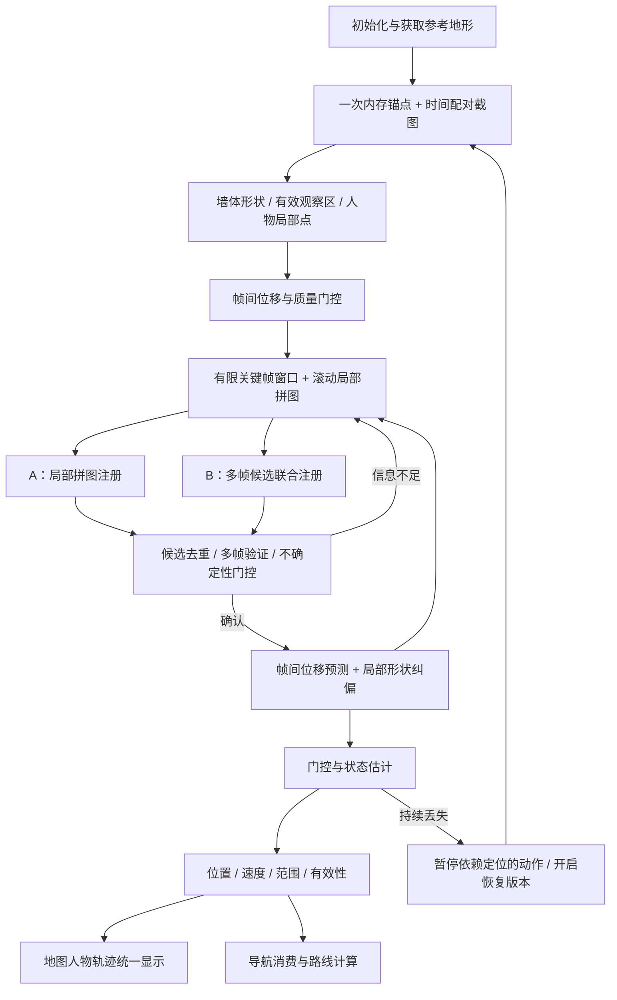

# PoE2 多帧全局定位、滚动局部地图与导航定位完整方案

日期：2026-09-23  
状态：逻辑与算法设计，待实验验证；本文不代表功能已经实现。  
实施边界：先在 PoE2 实验台验证，复用现有底层能力；新增策略先留在实验目录，契约稳定后再下沉。  
优先级：人物位置与监控墙体在参考地图上对齐 > 初始方向可信 > 连续跟踪 > 路线消费。本文的“导航定位”包含导航时的位置更新；路径规划和执行另列阶段，不作为首轮实验前置条件。

## 1. 目标与两个运行场景

| 场景 | 已有信息 | 要解决的问题 | 结果 |
|---|---|---|---|
| 首次全局定位 | 一次内存人物位置、参考地形、当前截图 | 确定方向、镜像、比例、平移；单帧不足时积累多帧 | 可信坐标变换、人物位置、候选范围 |
| 丢失后的全局恢复 | 新内存锚点、最近一段有效帧/局部拼图、旧变换先验 | 重建可靠对齐；排除旧方向、旧位移链污染 | 新注册版本、纠正后的位置与可信范围 |
| 正常导航定位 | 已确认变换、上一位置、连续截图 | 估计移动、约束漂移、监测失效 | 实时位置、速度、不确定性和有效性 |

前两行属于同一个“全局定位”组件，首次只是证据最少的调用场景。全局表示建立参考地图坐标系，并不要求每次搜索整张地形。

两个实验策略共享截图和关键帧，可单独或同时运行：

- A：移动并累计局部墙体，结构足够后注册拼图。
- B：维护方向/比例/镜像候选，用多个移动关键帧共同评价、淘汰和确认候选。

“成功”必须同时满足人物点对齐和可观测墙体对齐。把人物点直接画在内存位置上，只证明内存坐标可显示，不能证明视觉注册正确。

## 2. 整体流程

运动由用户手动产生；实验采集器只观察。以后执行自动移动时，执行适配器同样只能消费可信定位结果。

## 3. 坐标、时间和位移契约

### 3.1 坐标空间

| 符号 | 含义 | 单位 |
|---|---|---|
| I_t | 第 t 帧截图局部坐标，x 向右、y 向下 | 截图像素 |
| c_t | 当前帧人物局部坐标；单人模式为配置中心 | 截图像素 |
| L | 当前连续片段的局部地图坐标，固定在片段首帧 | 局部像素 |
| N | 未经页面旋转的 native 地形坐标 | native 网格 |
| D | 页面显示坐标 | 显示像素 |
| a_r | 恢复版本 r 在配对帧时刻的内存人物锚点 | native 网格 |

数组访问采用 `[y,x]`，点采用 `(x,y)`。所有业务定位、路径、锚点都以 N 交换；D 只用于显示。现有适配器若先应用人工方向配置，必须显式提供 N 到该参考空间的变换，不允许冒充 native 坐标或重复应用旋转。

### 3.2 墙体移动和人物移动符号

定义 d_t 为同一静态墙体从上一截图到本截图的位移：

    q_t = q_(t-1) + d_t
    o_0 = (0,0)
    o_t = o_(t-1) - d_t
    q_L = q_t + o_t
    p_L,t = c_t + o_t
    Δp_L,t = (c_t - c_(t-1)) - d_t

单人中心固定时，Δp_L,t = -d_t。人物向右走，小地图墙体向左移动，因此必须取负号。以后多人模式只替换 c_t 的来源，位移公式仍成立。

### 3.3 局部地图到 native 地形

    F_f = diag((-1)^f, 1), f ∈ {0,1}
    R_img(θ) = [[cosθ, sinθ], [-sinθ, cosθ]]
    M = s R_img(θ) F_f, s > 0
    T(q_L) = M q_L + b
    p_N,t = M(c_t + o_t) + b
    Δp_N,t = M[(c_t - c_(t-1)) - d_t]

θ 使用图像坐标角度，与现有 OpenCV 特征旋转约定一致。绕图像中心旋转产生的偏移必须并入 b；不能只记录角度而漏掉旋转中心。

如果第 r 帧与内存锚点配对：

    b = a_r + ε_a - M(c_r + o_r)
    p_N,t = a_r + ε_a + M[(c_t + o_t) - (c_r + o_r)]

ε_a 是受到锚点不确定性约束的小平移。此表达把位置搜索限制在锚点附近，重点搜索 θ、f、s。恢复时 r 是当前恢复基准帧，不能把新锚点套在片段初始帧上。

### 3.4 时间配对

每个锚点、截图、位移均有单调时钟时间和 frame_id。锚点读取与截图间隔 Δτ 的误差上界纳入锚点误差：

    ε_time ≤ v_bound · |Δτ|

初次方向未知时不凭空把时间误差换成某个方向的补偿，只增大允许范围；超过配对限额则此次锚点不可用于确认。重新配对属于显式受限恢复动作，不能悄悄连续读取。

## 4. 模块功能与复用边界

下列是逻辑模块，不强制“一模块一文件”。

| 模块 | 输入 → 输出 | 状态归属与实现策略 |
|---|---|---|
| ReferenceMapProvider | 地形快照 → native 地形、有效区、局部边界块 | 每地图实例一份；复用 terrain/reference 能力 |
| AnchorProvider | 地图实例 → 人物锚点与时间 | 复用一次性内存读取；PoE2 适配器拥有副作用 |
| FrameSource / EvidenceBuilder | 监控配置 → 截图、墙体、有效区、c_t | 复用独立 profile、截图与识别；采集一次供 A/B 使用 |
| ShapeNormalizer | 墙体/地形 → 统一轮廓、骨架、距离场 | 复用 canonical wall；新增形状选项先实验验证 |
| MotionEstimator | 相邻帧 → d_t、质量、Σ_d、失效原因 | 复用 phase displacement；不能把 response 当概率 |
| MotionGate / KeyframeSelector | 位移、覆盖、时间 → 静止/移动/未知、关键帧 | 新增通用语义策略；不依赖某游戏或按键 |
| EvidenceWindow | 有效帧 → 有界关键帧、位姿图边、来源索引 | 每会话独立；帧数/字节/时间/距离同时设限 |
| RollingSubmap | 关键帧与位姿 → 局部墙体和观察支持区 | 复用绘图融合能力；增加有界存储，不能复制全局大画布 |
| CandidateSearch | 局部形状、锚点 → 多个变换候选 | 复用 similarity search 思路；必须暴露候选和拒绝原因 |
| StrategyA | 局部拼图 → 经验证的注册候选 | PoE2 实验组合策略 |
| StrategyB | 多帧证据 → 候选轨迹、模式权重 | PoE2 实验组合策略；不逐帧整图穷举 |
| RegistrationValidator | A/B 候选与证据 → confirmed/ambiguous/insufficient | 统一门控；不把同源 A/B 当两份独立证据 |
| StateEstimator | 视觉移动、绝对观测 → 位置、速度、协方差 | 新增/复用通用滤波能力；首期用位移驱动 Kalman |
| RecoveryCoordinator | 连续质量与时效 → 恢复版本、一次锚点请求 | 复用 one-shot 生命周期，扩展收集/确认状态 |
| NavigationConsumer | 有效位置、地图、目标 → 路线/暂停/重规划 | 复用导航任务、规划能力；不导入 PoE2 细节 |
| Presentation / Archive | 诊断与结果 → 叠图、候选区域、可回放归档 | UI/文件适配器；归档显式开启 |

当前复用入口：`core/vision/phase_displacement.py`、`core/localization/{canonical_wall,displacement,frame_displacement,local_matcher}.py`、`core/mapping/stitcher.py`、PoE2 `stitching_session.py` 和 `experimental/hybrid_localization/`、`ui/modes/poe2_live_terrain/capture_test_page.py`。

现有 MapStitcher 有成熟的识别/融合入口，但持有画布；不能直接声称其已满足有界滚动窗口。现有 VisualLocalTracker 具备 F2F 成功优先、失败后局部匹配；本方案新增定期纠偏、协方差和多帧注册，不能以现有测试通过代替新链路验收。

## 5. 墙体表示与形状匹配

### 5.1 每帧预处理

1. 使用 profile 的颜色/预处理配置提取墙体，保留原始 mask 供诊断。
2. 清除人物小区域及配置的动态文字区域；圆形截图外部、遮挡和未显露部分标为“未知”。
3. 使用连通结构、局部厚度、时间一致性降低文字和传送门粗块权重。禁止把所有黄色或所有粗块当噪声删除。
4. 保留墙体原边界与骨架两种表示，统一尺度下做轻量断裂修复；骨架用于降低厚度差影响。
5. native 地形边界需区分可行走/不可行走界面和已知/未知界面；未知边缘不能自动当真实墙。

顶部排除 40 行是已有 200 像素样本的经验配置，不是跨分辨率、跨地图真理；新方案记录实际排除区域，避免一刀切丢掉有效墙体。

### 5.2 距离场与稳健形状误差

设 W_i 是截图轮廓点，V_i 是有效观察区，B 是参考墙体集合，D_B(x) 是到最近参考墙体的距离：

    E_forward(T) = Σ_(q∈W_i) w_q ρ(D_B(T(q+o_i))/σ_wall) / Σ w_q
    C_forward(T) = Σ w_q · 1[D_B(T(q+o_i)) ≤ τ_wall] / Σ w_q

ρ 可取 Huber 损失：

    ρ(u) = u²/2                       , |u| ≤ δ
           δ(|u| - δ/2)               , |u| > δ

对孤立噪声允许裁去固定上限比例的最大残差，并同时保留原始覆盖率，不能任意丢点使错误匹配变成满分。单位统一为 native 网格，σ_wall 随尺度和轮廓误差设定。

反向误差仅在双方确实可观察的支持区 Ω 内计算：

    Ω = T(V_i) ∩ reference_valid
    E_reverse(T) = mean_(x∈B∩Ω) ρ(D_(T(W_i))(x)/σ_wall)

未探索、被文字遮挡、被玩家标记清除、超出截图的区域不计反向缺失惩罚。没有可靠可见性证据时，反向分只作弱诊断；不能对整个地形裁块强制双向覆盖。

可选加入轮廓切向角的一致性，按模 π 比较，降低相邻平行墙/重复走廊的误配。形状分不能独立决定成功，必须通过锚点、尺度、运动和候选歧义检查。

### 5.3 搜索窗口

窗口由截图/拼图支持区经候选变换后的包围盒决定：

    ROI_N = bbox(T_h(V_window)) ⊕ (r_anchor + r_motion + r_wall)

⊕ 表示外扩。先用截图宽高、尺度候选范围和锚点估计粗 ROI，再逐候选收紧。150/110 是现有单帧探针参数，不能机械用于扩大的拼图；拼图变大需要更多墙体支持，但人物平移候选仍限制在锚点附近。

方向全域粗搜后精化，45° 只能作为粗采样，不可当最终角度。粗步长满足远端轮廓误差约 r·Δθ/2 不超过粗匹配容忍度；若取 45°，必须配合足够粗尺度和后续精搜，避免漏掉窄峰。

## 6. 运动检测与关键帧

### 6.1 相位相关

对有效墙体特征加窗后，归一化互功率谱并逆变换得到平移峰值：

    C = FFT(I_t) · conj(FFT(I_(t-1))) / (|FFT(I_t) · conj(FFT(I_(t-1)))| + ε)
    d_t = argmax IFFT(C)

具体 FFT 库符号可能不同，以第 3 节墙体位移定义和已知平移合成测试为准。评价 response、峰值比、位移后重叠轮廓误差和有效重叠面积；不只看一个 response。

### 6.2 静止不是低质量

- 质量高且位移接近零：静止。
- 质量高且累计位移超过门槛：移动。
- 质量低、遮挡、截图冻结或间隔太长：未知；不能判为静止。

静止时低频检测以发现重新移动；不保存重复关键帧、不增加拼图、不反复注册。静止但始终无法确认时显示“需要移动以增加结构”，不制造置信度。

关键帧条件：

    motion_valid ∧ (‖p_L,t - p_L,k‖ ≥ d_key 或 几何变化足够)
                 ∧ (新增有效覆盖足够 或 当前时间/方向跨度需要)

新增墙体增长、累计运动与时间跨度共同控制；连续缓慢移动不能因每帧死区被永久忽略，应与最近稳定参考累计比较。按键/手柄输入不能充当实际移动观测。

### 6.3 断链

若相邻帧无法可靠对齐：结束当前连通片段，保留旧片段诊断，不用零位移接上。可尝试对近期关键帧有界对齐；仍失败则新建片段并请求恢复。传送、地图缩放、窗口配置改变均可能需要新片段，不能硬套原比例和常速度。

## 7. 有界滚动地图与证据内存

### 7.1 三种数据分开

| 数据 | 保留策略 | 淘汰后含义 |
|---|---|---|
| native 参考地形 | 每实例一份紧凑共享基础数据；边界/距离场按 ROI 缓存 | 恢复和全图路线仍需要基础地形 |
| 视觉局部拼图 | 最近一段行程，固定块预算/范围/时间 | 细节变为未知，块不分配内存 |
| 截图与关键帧 | 有界环形缓冲；原图更短，关键 mask 更长 | 无法恢复历史原图，除非已显式归档 |

局部拼图外部“迷雾”是 absent/unknown 的默认查询值，不创建与全图等大的黑色/零值数组。显示缓存也必须使用视口裁块或低分辨率概览，否则逻辑图省内存而大 pixmap 仍占内存。

删除视觉拼图不等于删除 native 地形。若以后连参考地形也淘汰，则失去历史区域精细规划能力，必须明确重新加载/读取机制；本阶段保留一份。

### 7.2 滑窗与融合

保留最近 N_key 帧、T_window 时间或 L_window 行程内的数据，并受 B_memory 硬预算约束，任一超限先淘汰最旧证据。块稀疏存储，块内保存墙体支持权重、观察支持权重和最后更新时间。

仅对有效观察位置累积墙体证据：

    P_wall(x) = Σ_i w_i(x) · wall_i(x) / (Σ_i w_i(x) + ε)

wall_i(x) 和 w_i(x) 经帧位姿映射。未知位置 w=0；看不见墙不自动代表可行走。需要同时限制最少支持和单帧贡献，避免重复静止画面或文字永久固化。

滑窗移除帧后必须移除其贡献；首期可从保留关键帧重建小拼图，以免不可逆 OR 累积留下重影。位姿矫正后同样重建。块索引平移只改变存储原点，不改变 L/N 的物理坐标。

### 7.3 内存预算公式

    M_visual ≤ N_key·H·W·bytes_per_evidence
               + N_tile·tile_width²·bytes_per_cell
               + M_candidates + M_preview + M_workspace

示例：24 个 200×200 的 uint8 wall+valid mask 约 1.92 MB；1024×1024 等效局部区域若每格 8 bytes 约 8 MB。原图、距离场、临时变换、UI 图和线程副本另计，不能只报告 mask 大小。

2416×2277 单个 uint8 地形层约 5.50 MB；多个 float32 全局距离场和全图彩色副本会快速放大成本。A/B 共享只读帧与参考块，避免两套复制。

## 8. 方案 A：移动绘图后注册

### 8.1 过程

1. 获取时间配对的锚点与基准帧，建立片段 L。
2. 运动时累积有效关键帧，复用位移和局部融合能力建立拼图。
3. 有充分重叠的非相邻关键帧可增加校验边，减少 F2F 累积误差；不为每对帧全连接。
4. 检查结构条件，达到条件后冻结一个有版本号的证据快照进行注册。
5. 在锚点约束下搜索 θ/f/s/ε_a，用拼图形状评分。
6. 用最近未参与拟合的移动关键帧验证，或保留下一帧进行独立验证。
7. 确认后输出当前帧位置与注册；不把拼图起点位置冒充当前人物位置。

结构条件包括有效墙体骨架长度、覆盖面积、关键帧空间跨度、有效重叠和方向丰富度；“像素多”不足以区分一条长直线或大段文字。

### 8.2 位姿修正与防重影

设 o_i 为每帧放置偏移，d_ij 为帧 i 到 j 的墙体位移，可靠边约束：

    o_j - o_i + d_ij ≈ 0
    min_(o) Σ_(i,j) ρ(‖o_j - o_i + d_ij‖²_(Σ_ij^-1)), o_0 = 0

没有可靠边的帧不进入拼图。重叠残差异常时拒绝该帧/回退最后一致窗口，不继续把错误墙体画厚。位姿优化输出后重建局部拼图，不同时保留新旧轮廓。

### 8.3 触发控制

首次达到结构门才开始搜索；失败后，只有新增关键帧/覆盖达到增量门才重试。相同证据版本只匹配一次；到达采集上限仍歧义则明确未确认。

A 的优势是结构完整；主要风险是拼接误差。其误差应进入注册不确定性，不能把拼图当作无噪声真值。

## 9. 方案 B：多帧共同变换注册

### 9.1 候选和联合目标

候选 h 包含 θ_h、f_h、s_h、b_h、支持帧、有效观察范围和误差。所有帧共用同一个变换：

    E(h) = λ_a · ‖T_h(c_r+o_r)-a_r‖²_(Σ_a^-1)
           + Σ_i w_i [E_forward,i(h) + λ_r E_reverse,i(h)]
           + λ_o E_odometry(h) + λ_s E_scale(h)

若 o_i 已由同一 F2F 链确定，E_odometry 不再重复加入完全相同的约束；它只用于尚未使用的跨帧验证边或联合优化变量。候选人物轨迹由同一 T_h 变换得到，不允许每帧任意移动到高分位置掩盖错误方向。

### 9.2 过程

1. 初始有效帧生成少量不同方向/镜像/尺度 basin 的候选。
2. 新移动关键帧只评价现有候选对应的局部 ROI，精调有限邻域。
3. 在有新增证据时允许补入粗搜候选，防止正确方向在第一张稀疏帧被过早丢弃。
4. 用稳健联合误差累计支持；质量低的帧低权重或剔除。
5. 当一个模式稳定领先，且通过留出帧验证与位置/方向范围门时确认。

候选相对权重可表示为：

    w_h = exp(-(E_h-E_min)/τ) / Σ_j exp(-(E_j-E_min)/τ)

这是用于排序的相对权重，未校准前不标为“正确概率”。高度重叠的相邻帧降权/空间分组；不因多次观看同一墙体让置信度无限增加。

### 9.3 模式去重和保留

重复种子落入同一 θ/f/s/位置 basin 时先合并，不能作为第一、第二候选产生假歧义。真正不同的方向或镜像必须保留，不平均角度或位置；特别是两个相反方向候选可共享同一人物锚点，却把整个墙体朝向映射错误。

B 的优势是保留逐帧原证据，便于发现拼接污染；主要风险是重复结构和相关观测造成虚假收敛。必须保留角度/比例歧义，而不只报告一个很小的位置圆。

## 10. A/B 汇合与可信范围

### 10.1 同源结果不能重复计权

A/B 使用同一批截图和 F2F，结果相关。并排运行用于比较与一致性检查，不把 A+B 当双份独立测量做普通 Kalman 更新。首期选择验证更好的一个作为测量，另一个只做校验；冲突时保留两组候选并等待新增证据。

### 10.2 确认条件

- 锚点时间和地图实例一致。
- 有足够有效结构、有效关键帧与移动跨度，且位移链完整。
- 最佳模式在位置、方向、尺度上都有可接受的范围。
- 相对其他真实模式有稳定优势；不同 θ/f 不能仅凭锚点距离消歧。
- 留出帧的墙体投影与轨迹一致。
- A/B 同开时没有显著冲突；一致性只是必要检查之一。

单帧确实足够丰富时可走快速路径，但测试台仍单列“单帧确认”和“多帧确认”，不能把单帧锚点误差小当作方向稳定证明。

### 10.3 不确定性

对同一连续模式，令 η=(b_x,b_y,θ,log s)，估计参数不确定性 Σ_η，并传播到人物位置：

    P_position ≈ J_η Σ_η J_ηᵀ + M P_local Mᵀ + P_model

P_model 表示墙体模型、锚点时间、未建模变形等误差。相关项需纳入联合估计或采用保守上界，不能把相关项当独立项随意缩小。

单峰二维近似高斯时可画候选椭圆：

    (x-μ)ᵀ P_position^-1 (x-μ) ≤ 5.991

5.991 是二维卡方 95% 门，仅在协方差经过校准且近似假设适用时有该覆盖含义。第一版页面应标“估计候选范围”，不能宣称未经验证的 95% 可信率。

多峰时分开显示每个候选区域、方向区间和镜像状态，不画位于两个错误位置中间的平均点。还需展示截图四角投影范围，因为位置锚点可能很准而远端墙体因角度误差偏移很大：

    远端方向误差 ≈ s·r·|δθ|   （δθ 使用弧度）

## 11. 正常移动跟踪与时序状态估计

### 11.1 跟踪循环

确认注册后固定 θ/f/s：每帧估计 d_t，转换 Δp_N,t，更新位置；按累计距离、关键帧新增量或不确定性安排局部形状纠偏。平稳期不重跑全角度搜索。

F2F 失败时先用最后可靠预测做有界局部匹配；连续失败、范围超限或图像发生几何变化才进入全局恢复。F2F 即使一直报告成功也必须有周期性形状校验，否则慢漂移可能永不触发恢复。

### 11.2 图片中算法的准确位置

图片描述的是“物理门控 → 统计门控 → 预测/观测融合”。用于注册候选已明确后的时序跟踪；注册之前只能在每个候选内部使用，不能混合不同方向候选。

首期采用位移驱动的位置 Kalman，速度从观测位移估计供导航使用，避免同时加入常速度预测与同一 F2F 位移而重复移动：

    u_t = M[(c_t-c_(t-1))-d_t]
    p_t^- = p_(t-1)^+ + u_t
    P_t^- = P_(t-1)^+ + Q_t

Q_t 来自位移质量、帧间隔、变换不确定性与模型误差；相关性未建模时保守扩大。可平滑估计速度 v_t = (1-β)v_(t-1) + βu_t/Δt，但不得再把 v_t·Δt 加一次。

如果短时没有有效位移，可切到常速度预测 p^- = p^+ + vΔt，并快速增大 Q；此时输出 predicted，不称为新观测定位。超过时间/范围限制停止预测。

### 11.3 观测门控与融合公式

z_t 为局部形状注册给出的 native 人物位置，R_t 为该观测的不确定性。

物理门控：

    ‖z_t-p_last_confirmed‖ ≤ v_max·Δt_since_confirmed + ε_motion

v_max 要根据 native 单位和实测移动能力校准；传送/切图不能按普通高速移动处理。

统计门控：

    e_t = z_t - p_t^-
    S_t = P_t^- + R_t
    D² = e_tᵀ S_t^-1 e_t

仅当 D² 在门限内且形状/时效有效时融合：

    K_t = P_t^- (P_t^- + R_t)^-1
    p_t^+ = p_t^- + K_t(z_t - p_t^-)
    P_t^+ = (I-K_t)P_t^-(I-K_t)ᵀ + K_t R_t K_tᵀ

这是图中“预测×(1-K)+观测×K”的矩阵形式。R_t 由轮廓残差、遮挡率、尺度/方向不确定性估计；不能把 score 简单解释成方差或把 phase response 当概率。

当前帧同时参与 F2F 和形状匹配时二者相关。首版用稀疏关键帧纠偏、误差下限和保守膨胀，不凭公式声称严格最优；后续需要时用联合模型或协方差交集处理未知相关性：

    P_CI^-1 = ωP_1^-1 + (1-ω)P_2^-1
    μ_CI = P_CI[ωP_1^-1μ_1 + (1-ω)P_2^-1μ_2]

即使使用 CI，也要求两个估计各自的不确定性合理。不同注册模式始终分开，不能用 CI 隐藏歧义。

### 11.4 静止与数据时效

静止时维持最后确认位置和低频检测；重复同帧不缩小方差。显示位置可保留，但同时输出 age_ms、fresh=false。视窗冻结、低质量与真正静止分别记录。滤波只提高连续性，不能把错误方向、错误截图配置或长期漂移“平滑正确”。

## 12. 首次和恢复的完整时序

### 12.1 首次定位

    获取地形 → 校验 profile/截图几何 → 内存锚点与首帧配对
    → 单帧候选诊断 → 不足则提示移动
    → 采集有效运动关键帧 → A/B 注册 → 留出帧验证
    → 发布 confirmed registration → 开始正常视觉跟踪

采集期间可以展示内存锚点，但来源标为 memory_anchor，视觉状态仍是 collecting/ambiguous。旧变换不能用于渲染成“已校准成功”。

### 12.2 运行中恢复

    纠偏持续失败/预测范围超限/几何突变
    → tracking 降级并让导航暂停
    → recovery_revision + 1
    → 一次新内存锚点 + 当前帧配对
    → 取与当前帧可靠连通的近期关键帧/拼图
    → prior 方向快搜，失败时同锚点下完整方向搜索
    → A/B 多帧确认 → 重置滤波到新注册 → 导航重规划

已有近期图仅在位移链可靠时复用；断链前的帧不可强拼到当前锚点。换地图实例必须丢弃旧地形和注册。静态截图/旧快照无法保证识别所有切图事件，实例确认需依赖明确区域信号或受限元数据检查；不能承诺零读取还可靠检测任意切图。

一版恢复只消费一次锚点，随后可在证据新增时做有限次计算。超时、停止或失败进入等待，禁止后台无限新开恢复版本。用户重试或明确的新有效事件才允许开启新版本；一次恢复确认后重新计数。

### 12.3 状态表

| 状态 | 意义 | 转移 |
|---|---|---|
| IDLE | 未运行 | 手动开始 → ANCHORING |
| ANCHORING | 一次配对读取 | 成功 → COLLECTING；失败 → WAITING |
| COLLECTING | 等待移动/结构 | 证据达到门限 → REGISTERING |
| REGISTERING | 在冻结证据版本上计算 | 确认 → TRACKING；歧义 → COLLECTING；超限 → WAITING |
| TRACKING | 可信视觉跟踪 | 质量下降 → DEGRADED；停止 → IDLE |
| DEGRADED | 短暂预测，导航不可执行 | 纠偏恢复 → TRACKING；超过界限 → RECOVERING |
| RECOVERING | 单次恢复版本 | ANCHORING → COLLECTING/REGISTERING |
| WAITING | 失败或证据不足 | 显式重试/有效新事件 → 新恢复版本 |

算法任务携带实例、profile_version、segment_id、recovery_revision、evidence_version。结果返回时任何版本不符即丢弃，防止重置/换图后旧后台结果覆盖新状态。

## 13. 定位向导航的契约

定位输出至少包含：

| 字段 | 含义 |
|---|---|
| position_native、velocity_native | 当前估计位置和速度 |
| coordinate_space、instance_id | 坐标与地图身份 |
| registration_version、transform | 方向/镜像/比例/平移及版本 |
| covariance、candidate_regions | 单峰协方差或多峰候选集合 |
| status、source、fresh、age_ms | confirmed/predicted/ambiguous/lost 与来源/时效 |
| frame_id、timestamp、reason | 消费方可追踪的证据和失效原因 |

导航不读取 UI 圆点当真值。首轮实验仅可视化位置/范围；以后路径模块仅在 confirmed、fresh、实例一致且误差满足容差时输出可执行意图。

### 13.1 路线计算

目标 g 与当前位置都在 native 坐标。依据参考地形构造可行走图，障碍按人物半径和定位误差外扩：

    r_safe = r_player + k·sqrt(λ_max(P_position)) + r_map_error

若保守外扩堵住窄通道，应请求更精确定位，不可直接减小安全半径。墙体形状用于匹配，不自动等价于可行走分类；迷雾/未知默认不通行，探索策略以后另配。

可复用 A*：

    cost(u,v) = distance(u,v) + λ_clearance·risk(u,v), risk ≥ 0
    f(n) = g(n) + h(n)

h 采用与连接方式和单位相容的距离下界。全图静态路径读取紧凑 native 地形；视觉滚动地图用于定位，不承担无限历史路线记忆。动态障碍需要独立感知更新，不由静态地形保证。

### 13.2 导航时运动闭环

    有效定位 → 路径最近投影点 → 前视目标 → 领域移动意图
    → 执行适配器 → 新截图 → 视觉实际位移 → 定位更新

native 方向不能直接当 Xbox/屏幕方向：屏幕/控制映射是另一个需校准的适配器，必须使用正确逆变换和轴约定。执行意图不反过来充当“人物已移动”的测量。

定位丢失、候选多峰或过期：暂停依赖定位的移动。恢复成功或 registration_version 改变：从新位置重规划，不能沿旧路径投影盲目继续。

## 14. 统一显示与实验页面

### 14.1 显示变换

    p_D = H_DN p_N
    polygon_D = H_DN T(V_t + o_t)
    P_D = J_DN P_N J_DNᵀ

地图、人物、轨迹、监控视野多边形和候选椭圆都使用同一 H_DN。页面逆旋转、镜像、跟随放大只影响显示；不修改 native 定位结果。点击目标使用 H_DN 的逆变换。

图上必须能同时看到：人物中心、监控范围映射后的轮廓、视觉墙体与参考墙体叠图。仅看人物是否接近锚点无法判定方向正确。

### 14.2 页面内容

- 选择 A、B 或同源并排对比；开始、停止、重置、保存本次实验。
- 当前截图、有效观察区、清理后墙体、滚动局部拼图。
- 地图上的当前人物、最后可信点、候选区域、方向区间和监控视野投影。
- 移动/静止/未知、关键帧数、移动跨度、有效结构、内存占用。
- A/B 的结果与差值、前两候选、留出帧误差、拒绝原因。
- 内存读取次数、恢复版本、证据版本、每阶段耗时、结果年龄。

人工验证按钮可一次读取当前位置并同步截图，只作评估真值，不反馈给正在评估的视觉算法。若把验证锚点也送入算法，就不能再把该帧位置误差当独立验证结果。

### 14.3 调度与日志

截图/预览、证据处理、昂贵注册分开调度。一个会话最多一个注册任务；有限队列，积压时丢弃旧待处理项并记录间隔，超过位移可追踪范围则断链。计算时预览继续，结果只能落到对应版本。

计算使用冻结的关键帧快照，不锁住 UI 等待。帧/墙体只读共享，拼图由所属会话管理，A/B 不改对方状态。

归档包含原图、wall/valid mask、所有时间戳、锚点及读次数、d_t/质量、关键帧取舍、局部原点、各变换、候选分解、配置版本和最终状态。窗口内失败快照可保存；长期归档采用文件数/字节保留策略。纯运行默认只保留有界缓存。

## 15. 参数和验收

下列数值仅用于第一轮实验起点，必须按真实数据调整；不属于当前已经验证的默认值。

| 参数 | 初始实验建议 | 依据与约束 |
|---|---|---|
| 静止检测频率 | 2–5 Hz | 仅作唤醒探测；低频采样跳变过大时增加频率或断链 |
| 移动采样频率 | 10–15 Hz | 由最大可匹配位移和实际移动速度限制 |
| 关键帧间距 | 截图边长的 5%–10% | 在局部像素中计算，确保有重叠 |
| A/B 最少移动关键帧 | 4–6 帧 | 需不同位置和足够结构，数量不是单独成功条件 |
| 关键帧上限 | 24 帧 | 同时受字节/距离/时间限制 |
| 窗口时长 | 15–30 秒 | 静止不反复加入帧；超时后按有效性重建 |
| 等效局部图范围 | 约 1024×1024 局部像素预算 | 实际按稀疏块与移动跨度控制 |
| 候选模式上限 | 8–16 个 | 保留不同 θ/f/s basin，去掉重复种子 |
| 短暂预测容忍 | 0.3–0.5 秒起测 | 还受方差上限限制，不构成允许继续自动移动 |
| 注册任务 | 每会话最多 1 个 | 同证据版本不重复匹配 |

针对“是否真正对齐”，记录下列指标：

    e_position = ‖p_est - p_validation_memory‖
    e_wall = median distance(projected_visual_wall, reference_wall)
    e_track = discrepancy(projected_visual_displacement, validation_displacement)
    e_view = projected viewport edge uncertainty

用户实测前需选定业务容忍度 e_pos_max/e_wall_max，单位明确为 native 网格；方向容忍度由 e_wall_max 与观察半径反推，不能随意写“允许几度”。

验收矩阵：

| 场景 | 必须观察到的结果 |
|---|---|
| 已知旋转/镜像/尺度的合成帧 | 点、位移、视野投影和显示逆变换一致 |
| 墙体宽度不同、文字/传送门噪声 | 结构仍能匹配；失败时给出证据不足而不是假确认 |
| 首帧墙少，移动后结构增加 | A/B 可随新增证据收敛；记录到确认的时间/距离 |
| 长直走廊、重复结构 | 保留多峰/方向歧义，不依靠滤波制造唯一答案 |
| 人物静止 | 关键帧和注册次数不增长，内存有界 |
| 连续移动 | 轨迹方向一致，周期纠偏阻止无限漂移 |
| 遮挡、截图冻结、丢帧、地图缩放 | 未知/断链/恢复正确，旧结果不冒充新帧 |
| 真实丢失后恢复 | 新锚点配对当前帧，同版本只读一次；近期可靠图可复用 |
| 换图/改 profile/停止后旧任务返回 | 版本门丢弃旧结果，无状态串用 |
| 长时间运行和往返 | 块、关键帧、缓存、任务队列均有界；重影不累积 |

A/B 必须在同一批留出轨迹上比较：确认成功率、错误确认率、位置/墙体误差 P50/P95、确认耗时/行走距离、峰值内存、恢复读次数。参数调整使用训练回放，最后验证保留未调参的地图/轨迹，避免把单个样本调通当泛化成功。

## 16. 实施阶段与交付边界

| 阶段 | 交付 | 完成条件 |
|---|---|---|
| P0 坐标和证据 | 时间配对、四坐标变换、有效观察区、可回放数据契约 | 已知变换和真实样本叠图无方向/偏移歧义 |
| P1 共享运动与滚动缓存 | 运动门控、关键帧、断链、有界拼图 | 静止不积累、长跑内存稳定、重影可诊断 |
| P2 方案 A | 阈值触发拼图注册、留出验证、失败原因 | 同锚点范围下比较单帧与拼图效果 |
| P3 方案 B | 候选共同变换、多帧评分、可信范围 | 保留真实歧义，新增移动帧能正确筛选 |
| P4 首次/恢复实验台 | A/B 共源对照、完整日志/归档、异步版本门 | 首次与恢复都走相同确认条件，可复放 |
| P5 连续导航定位 | F2F + 稀疏纠偏 + 位移驱动滤波 + 恢复状态机 | 位移准确、漂移受控、视觉丢失能触发且不循环读内存 |
| P6 导航集成 | 路线消费、暂停/恢复/重规划、可视化 | 定位有效性门、地图单位和版本正确 |
| P7 可选执行接入 | 控制坐标校准、领域意图到设备适配 | 另行验证实际移动；不是当前定位实验交付 |

每阶段维护断点：已验证内容、失败样本、参数版本、下一入口。P0–P4 优先解决全局定位；P5 才把新确认能力接到连续定位，P6/P7 不能掩盖首帧仍不稳定的问题。

## 17. 对此前讨论的明确修订

1. 卡尔曼滤波能管理时序误差，不能解决尚未确定的旋转/镜像，也不能保证重复结构单帧唯一。
2. A/B 共用证据，因此一致不代表两次独立验证；需要留出帧和独立验证位置。
3. 新增的是移动中的关键帧；静止仍需轻量探测，否则无法检测重新开始移动。
4. 局部拼图可以有界且窗口外不分配像素；native 参考数据、概览和临时图仍计入内存预算。
5. 全局恢复复用近期图的前提是与恢复基准帧连通；不能用新锚点给旧断链拼图强行定位。
6. 位置锚点准确不等于监控墙体对齐；必须评估方向、比例以及视野远端投影误差。
7. 所有确认、置信范围和性能要求均需真实样本校准；本文没有宣称尚未实现的多帧系统已经稳定。
